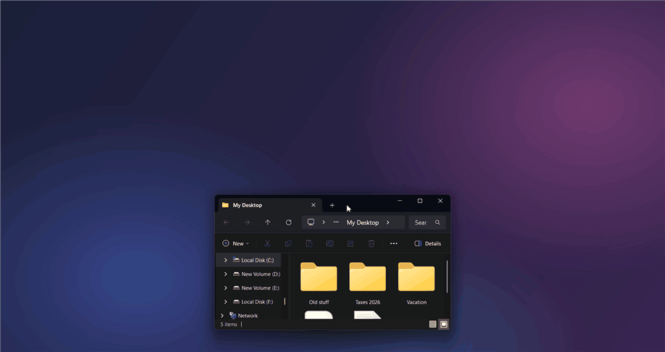

# 🧺 Desktop Wardrobe

**Hang your desktop clutter on a clothesline.** Like Fences, but fun.

[](https://github.com/Malik-Pashayev/DesktopWardrobe/releases/latest/download/DesktopWardrobe.exe)

Push the mouse against the top of the screen and a rope drops down with your folders pegged to it by wooden clothespins. Drag things up to hang them and they leave your desktop. Pull them back down whenever you need them.



## Download

[](https://github.com/Malik-Pashayev/DesktopWardrobe/releases/latest/download/DesktopWardrobe.exe)

Click the button to download **`DesktopWardrobe.exe`**, then double-click it. There's nothing to install. It runs on Windows 10 and 11 (x64) and lives in the system tray. To have it start with Windows, right-click the tray icon → **Start with Windows**.

All versions are on the [releases page](../../releases).

> **"Windows protected your PC"?** The app isn't code-signed yet, so SmartScreen warns about it. Click **More info → Run anyway**. The source is all here if you'd rather [build it yourself](#build-it-yourself).

There's also a tiny `DesktopWardrobe-small.exe` (~200 KB) if you already have the [.NET 9 Desktop Runtime](https://dotnet.microsoft.com/download/dotnet/9.0).

## What it does

- 🧹 **Actually declutters.** Hung items are *moved* off the desktop, not shortcut. Your desktop stays clean.
- 🪝 **Hang anything.** Folders, documents, zips, shortcuts: drag them to the top edge of the screen.
- 👋 **Take it back.** Drag an item off the line onto the desktop, or anywhere in Explorer.
- 🔀 **Rearrange.** Pick an item up and it dangles from your mouse while the others slide aside to make room.
- 🧺 **More lines when it's full.** A second (and third) rope appears underneath.
- 📤 **Upload straight from the line.** Drop an item into a browser's upload area, or right-click → *Copy* and paste it into Gmail, Slack or ChatGPT.
- 🪢 **Real rope physics.** The line sags under each item, dips when something lands and settles with a gentle sway.
- 🫥 **Out of the way.** No window and no background, just the rope. It never pops up over fullscreen games or videos, and uses no CPU while idle.

## Where do my files go?

Hung items are moved to a normal folder called **`Desktop Wardrobe`**, right next to your Desktop folder
(`C:\Users\you\Desktop Wardrobe`, or `OneDrive\Desktop Wardrobe` if your desktop syncs with OneDrive).

- Moving is an instant rename on the same drive, even for huge folders.
- **Nothing is ever deleted.** If you uninstall the app, everything is still in that folder.
- Tray menu → **Show in Open/Upload dialogs** pins the folder to Quick access, so file pickers can reach it.
- Tray menu → **Put everything back on the desktop** undoes it all.

## How is this different?

| | What it holds | Moves files off the desktop | Lives |
| --- | --- | --- | --- |
| **Desktop Wardrobe** | Any files and folders | ✅ | On a rope at the top of the screen |
| [Fences](https://www.stardock.com/products/fences/) | Desktop icons | Groups them in boxes *on* the desktop | On the desktop (paid) |
| [Edge-Drop](https://github.com/Deepender25/Edge-Drop), [DragStash](https://apps.microsoft.com/detail/9ng4x52dz9tf), [Holdem](https://github.com/iamzubin/holdem) | Temporary drag & drop shelf | ❌ | Screen edge / floating shelf |
| [Snapline](https://github.com/mohabujubara/snapline) | Screenshots only | ❌ | On a line at the top of the screen |

## Tips

| Do this | To |
| --- | --- |
| Rest the mouse on the top edge | Open the line |
| Drag a file up to the top edge | Hang it (the line opens by itself) |
| Click an item | Open it |
| Drag an item along the line | Reorder |
| Drag an item down off the line | Put it back on the desktop |
| Right-click an item | Open, put back, copy, show in Explorer |

## Build it yourself

```powershell
git clone https://github.com/Malik-Pashayev/DesktopWardrobe.git
cd DesktopWardrobe
dotnet run --project src/DesktopWardrobe
```

Needs the .NET 9 SDK. It's plain WPF with no dependencies.

## How it works

- **A see-through window.** A transparent, always-on-top WPF window covers the top of the screen. While the line is up, every pixel is fully transparent, so clicks pass straight through. While it's down, the background is alpha 1: invisible, but still enough for Windows to deliver drops to it.
- **The rope** is a chain of 33 points simulated with Verlet integration and distance constraints. It runs on a fixed 120 Hz time step, since Verlet gains energy if fed uneven frame times. Pegged items add weight to the points either side of them, which is why the line dips under each one.
- **Each item** is a damped pendulum pivoting on its peg, driven by the sideways acceleration of the rope (or your mouse, while you carry it).
- **Sleep.** Once the rope and the items are still, they stop simulating and redrawing entirely. That keeps idle CPU at 0% even though WPF has to copy the whole transparent window on every frame.
- **Icons** come from `IShellItemImageFactory` on a background STA thread. It only uses thumbnails Explorer has already cached, so OneDrive files never get downloaded just to draw an icon.

## License

[MIT](LICENSE)
